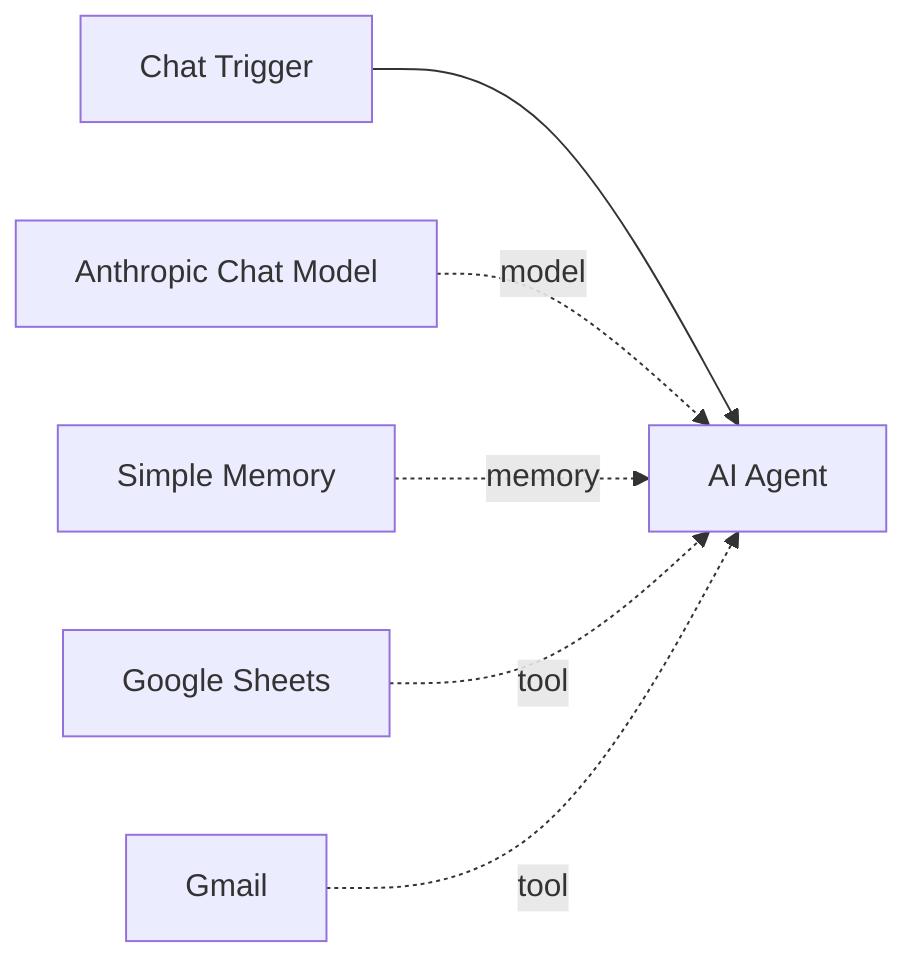

<div align="center">


# DataPilot AI

### Ask your spreadsheet. Understand the answer. Deliver with confidence.

An evidence-backed **n8n prototype** connecting conversational chat, an Anthropic Chat Model, Google Sheets, Simple Memory, and Gmail.

[](docs/PROJECT_REPORT.md)
[](https://n8n.io/)
[](https://www.anthropic.com/)
[](https://sheets.google.com/)
[](https://mail.google.com/)
[]()

**[🎬 Launch interactive presentation](presentation/datapilot-ai-presentation.html)** · **[📄 Project report](docs/PROJECT_REPORT.md)** · **[🧩 Workflow requirements](workflows/README.md)** · **[🧭 Presentation content](presentation/slides.json)**

</div>

<br>

> [!IMPORTANT]  
> **Status: prototype.** Small-sheet interaction and delivery of a static email are demonstrated in supplied screenshots. Large raw-row model input failed. An end-to-end data-derived report and the original sanitized workflow export are still pending.

## What DataPilot AI does

DataPilot AI explores a practical automation path:

```text
Ask → Retrieve spreadsheet context → Reason with AI → Deliver by email
```

| Capability | What it means |
|---|---|
| 💬 **Ask** | A Chat Trigger sends a natural-language request to the AI Agent. |
| 🧠 **Analyze** | Anthropic provides model reasoning, while Simple Memory preserves conversational context. |
| 📊 **Retrieve** | Google Sheets supplies spreadsheet context for the workflow. |
| 📧 **Deliver** | Gmail is the delivery channel for the workflow output. |

Connected tools do not necessarily execute on every request.

## Evidence board

| Capability | Evidence and boundary |
|---|---|
| Spreadsheet retrieval | ✅ Sheets output shows successful retrieval |
| Small-sheet response | ✅ One agent result displays 43 data rows plus a header |
| Email delivery | ⚠️ A received email contains a static greeting, not an analytics report |
| Large-data processing | ❌ 20,407 returned items followed by `request entity too large` |
| Dynamic analytics email | ⏳ Not yet verified |
| Reproducible workflow import | ⏳ Blocked until the original workflow JSON is provided |

## Architecture



### Target redesign

The next architecture reduces raw-row model input:

```text
Google Sheets → External aggregation → Compact validated summary
              → Anthropic explanation → Approval → Gmail delivery
```

This approach calculates counts and aggregates outside the model, sends a compact validated summary for explanation, and adds an approval step before the email action.

## Interactive presentation

Explore the project through a self-contained, animated presentation:

[](presentation/datapilot-ai-presentation.html)

The presentation covers the workflow architecture, demonstrated evidence, scaling boundary, target redesign, deliverables pipeline, privacy approach, and roadmap.

## Start here

- [Project report](docs/PROJECT_REPORT.md): architecture, evidence, setup, tests, privacy, limitations, roadmap, and interview notes.
- [Workflow export requirements](workflows/README.md): original JSON still pending; no fabricated workflow included.
- [Presentation content](presentation/slides.json): twelve-slide narrative with speaker notes.
- [Interactive presentation](presentation/datapilot-ai-presentation.html): animated HTML experience.

## PPT, PDF, and Word report

The repository includes the source and build script for editable PPTX, PDF, and DOCX deliverables. The **Build project package** GitHub Actions workflow generates them and uploads a `datapilot-project-package` artifact. Its successful execution must be checked; no hosted build is claimed before it runs.

Open **Actions → Build project package → successful run → Artifacts** to access the generated bundle. Binary files are generated as artifacts, not committed directly to the repository.

### Build locally

```bash
python -m pip install -r requirements.txt
python scripts/validate_fixture.py
python -m unittest discover -s tests -v
python scripts/build_deliverables.py
```

## Tests and maturity

The included eight-row fixture is fictional. Fixture tests check calculations and invalid inputs only; they do not run n8n, the model, Google Sheets, or Gmail. Currency is unspecified.

No customer adoption, ROI, accuracy percentage, SLA, deployment claim, or security certification is made.

Original screenshots and raw source data are excluded because they contain personal contacts, private workspace details, or source records. Evidence observations are recorded in the report; images are not public in this repository.

## Roadmap

- [ ] Provide and import the original sanitized workflow JSON
- [ ] Verify end-to-end data-derived email delivery
- [ ] Implement external aggregation for large datasets
- [ ] Add a controlled approval flow for email actions
- [ ] Expand validation beyond the eight-row fixture

## Project owner

Built by [AnyalstRushi](https://github.com/AnyalstRushi) · Documentation prepared 7 October 2026

No reuse license has been selected; third-party software retains its own terms.

---

<div align="center">

**ASK. ANALYZE. DELIVER.**

⭐ If DataPilot AI helps you think about AI automation and spreadsheet workflows, star the repository.

</div>